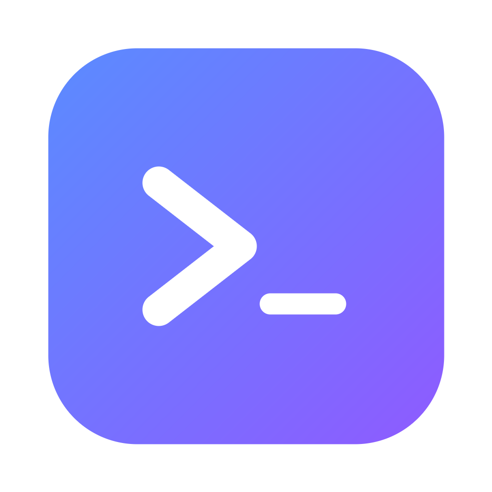
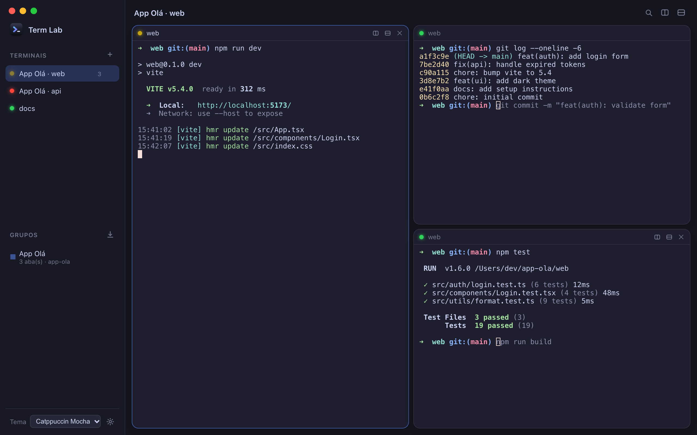
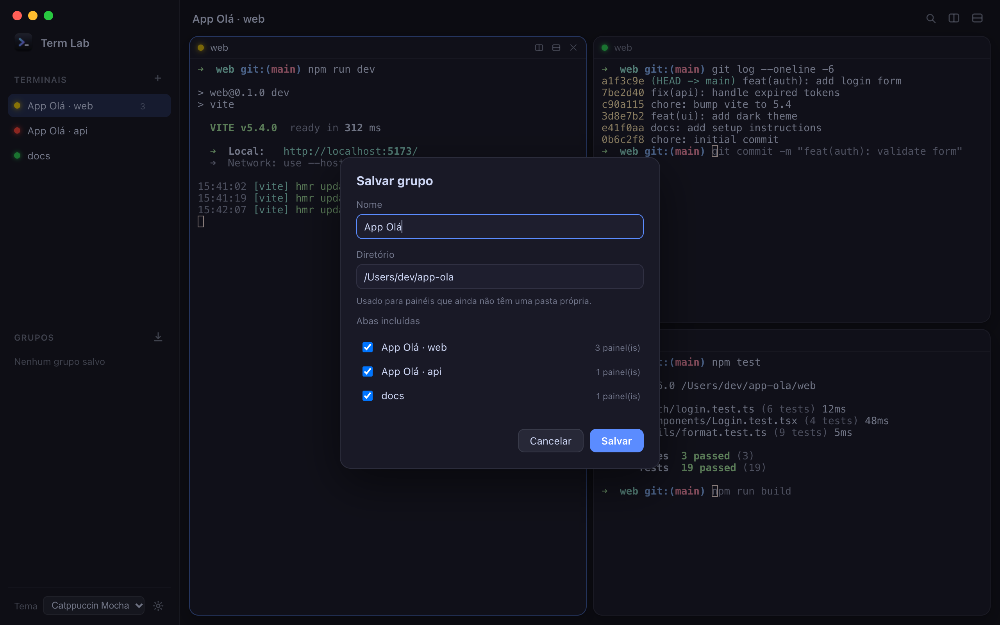
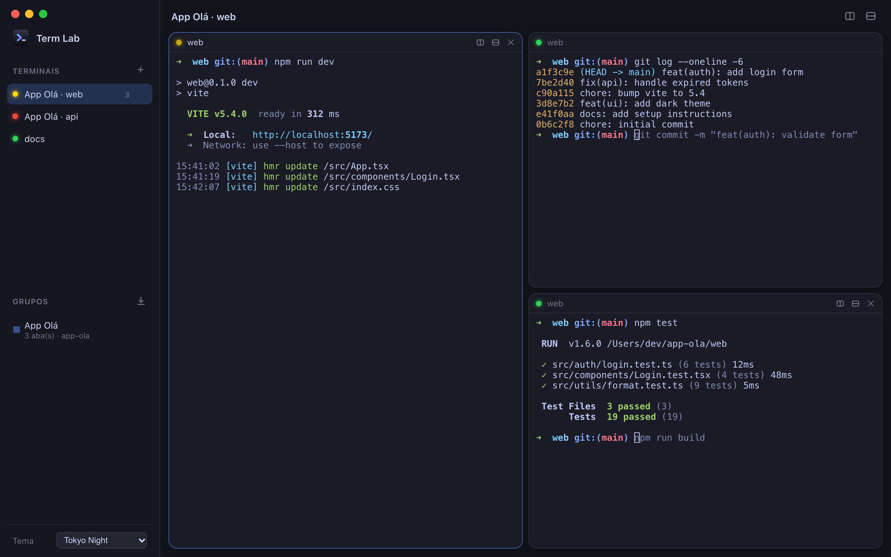

<p align="center">
  
</p>

<h1 align="center">Term Lab</h1>

<p align="center">
  Um terminal desktop para macOS que centraliza suas sessões em uma interface limpa, no estilo OrbStack:<br/>
  sidebar de sessões, painéis reorganizáveis, status em tempo real e grupos de abas salvos por projeto.
</p>



> Os prints são gerados a partir da interface real, com saídas de shell simuladas (`npm run screenshots`).

## Funcionalidades

- **Sessões na sidebar** — cada aba é uma sessão de terminal; clique para alternar, `+` para criar.
- **Painéis estilo tiling** — divida ao lado ou abaixo, **arraste o cabeçalho** de um painel para reorganizar (soltar na borda encaixa, no centro troca de lugar) e redimensione pelos divisores.
- **Renomear abas** — duplo clique no nome da aba (ou no título do topo). Nome vazio volta ao nome automático (pasta atual).
- **Status em tempo real** — a bolinha da aba mostra o que está acontecendo:

  | Cor | Significado |
  | --- | --- |
  | 🟢 verde | ocioso / último comando concluído com sucesso |
  | 🟡 amarelo (pulsando) | há um comando em execução (ex.: `docker build`, `npm run dev`) |
  | 🔴 vermelho | o último comando terminou com erro (exit code ≠ 0) |

  Na aba, a cor resume todos os painéis: amarelo se algum estiver rodando, senão vermelho se algum falhou. `Ctrl+C` não conta como erro.
- **Grupos** — salve um conjunto de abas com nome e diretório (ex.: **App Olá** com os terminais de backend e frontend) e reabra tudo com um clique, com layout e pastas preservados.
- **Temas** — Catppuccin Mocha, Dracula e Tokyo Night, com contraste ajustado para textos apagados e _autosuggestions_.
- **Terminal de verdade** — PTY real (`portable-pty`) renderizado com [xterm.js](https://xtermjs.org/): cores, links clicáveis e busca.

<details>
<summary>Mais prints</summary>




</details>

## Atalhos

| Atalho | Ação |
| --- | --- |
| `⌘T` | Nova aba |
| `⌘D` | Dividir painel ao lado |
| `⌘⇧D` | Dividir painel abaixo |
| `⌘W` | Fechar painel em foco |
| Duplo clique na aba | Renomear |

## Requisitos

- macOS
- [Node.js](https://nodejs.org/) 20+
- [Rust](https://rustup.rs/) (toolchain estável)

## Desenvolvimento

```bash
npm install
npm run tauri dev
```

Gerar o app (`.app` / `.dmg`) para macOS:

```bash
npm run tauri build
```

### Docker

O Docker serve para instalar dependências e validar/compilar **para Linux** sem poluir a máquina. Como o Tauri abre uma janela nativa, o app não é exibido a partir do container.

```bash
docker compose run --rm check   # tsc + cargo check
docker compose run --rm build   # tauri build (Linux)
docker compose up dev           # Vite em http://localhost:1420
```

## Como o status funciona

Ao iniciar um shell **zsh**, o backend usa um `ZDOTDIR` temporário que carrega seus dotfiles normalmente e, ao final do `.zshrc`, registra hooks `preexec`/`precmd` que emitem sequências OSC:

| Sequência | Uso |
| --- | --- |
| `OSC 133;C` | um comando começou a executar |
| `OSC 133;D;<código>` | o comando terminou, com seu exit code |
| `OSC 7` | diretório atual (usado no nome da aba e nos grupos) |

O frontend interpreta essas sequências para colorir as bolinhas. Outros shells funcionam normalmente, mas sem status e sem diretório atual.

## Estrutura

```
src/
  main.ts       interface: abas, painéis, status, grupos
  layout.ts     árvore de layout dos painéis (funções puras)
  groups.ts     persistência dos grupos (localStorage)
  themes.ts     temas do terminal
src-tauri/
  src/main.rs   PTY, integração com zsh e ícone do Dock
assets/icon.svg fonte do ícone do app
scripts/        gerador de prints
docs/screenshots/
```

## Ícone e prints

```bash
# Ícone: edite assets/icon.svg, renderize para app-icon.png (1024×1024, transparente) e gere o conjunto
npx tauri icon app-icon.png

# Prints do README (usa o Chrome instalado; defina CHROME_PATH se necessário)
npm run screenshots
```

O ícone aparece no Dock (inclusive em `tauri dev`, definido em runtime), na janela, no `.app`/`.dmg` (`icon.icns`), no favicon e na sidebar.
